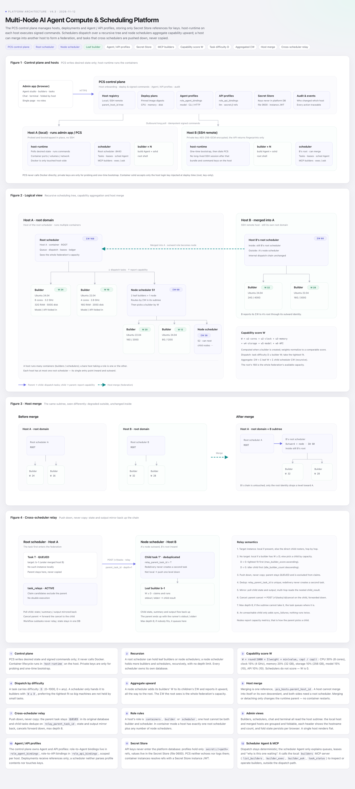
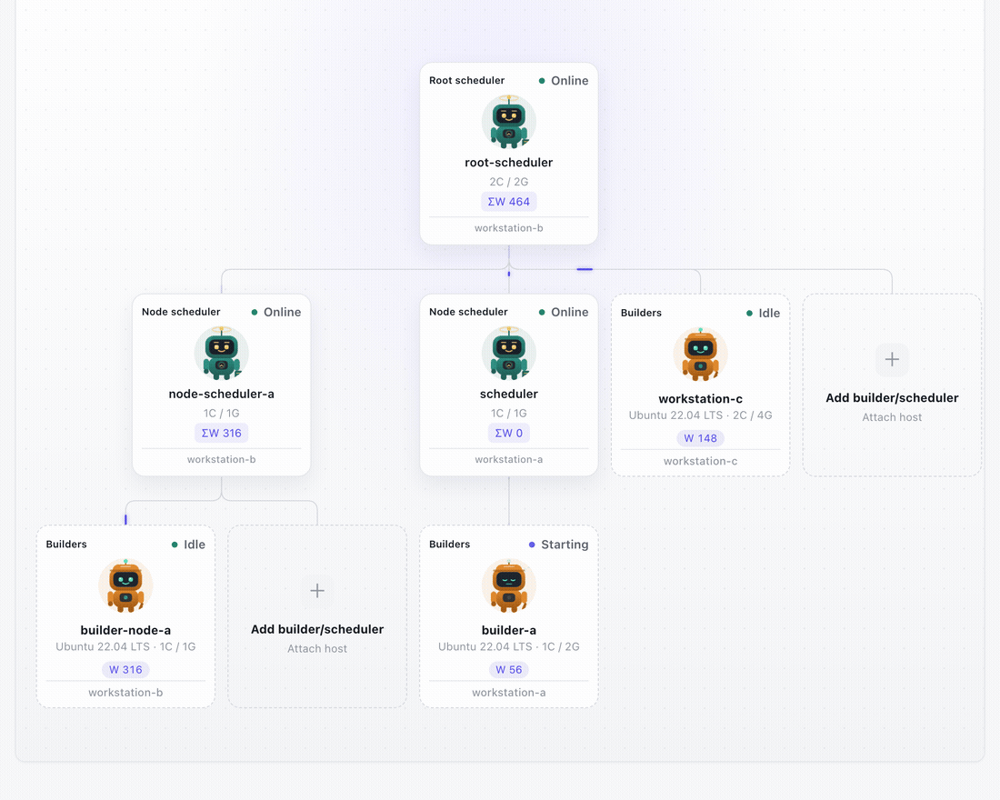
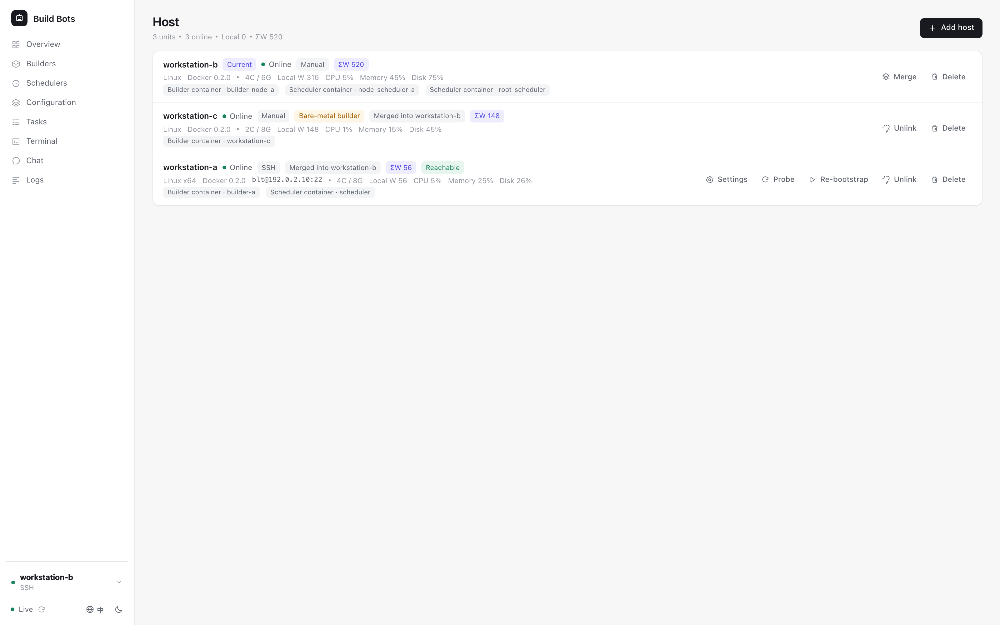
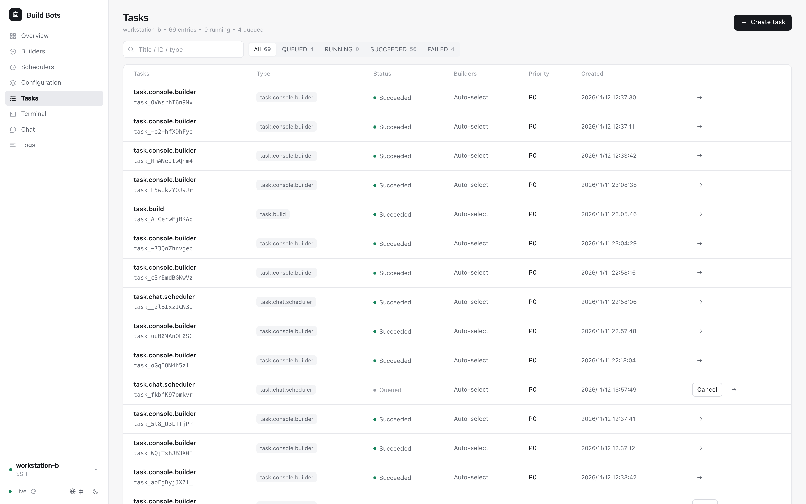

<div align="center">

# Multi-Node AI Agent Compute & Scheduling Platform

**Run Claude Code, Codex, DeepSeek or plain shell on any number of hosts — with deterministic scheduling, recursive schedulers and full-root builders.**

[Quick start](#quick-start) · [Architecture](#architecture) · [Screenshots](#product-tour) · [Docs](#documentation) · **[简体中文](README.zh-CN.md)**

[](https://github.com/UnmetDecade/OSACP/actions/workflows/ci.yml)
[](LICENSE)
[](https://github.com/UnmetDecade/OSACP/releases)


</div>

---

AI coding agents are easy to start and hard to operate across machines. This platform keeps the operational core **boring and deterministic**: a scheduler decides, a builder executes, and an Agent only explains.

It is built for a small R&D team that wants a real compute floor — not a multi-tenant SaaS, not a Kubernetes distribution, and not another approval workflow.


## Why this exists

| | |
|---|---|
| **Deterministic dispatch** | Queue order, admission, leases and fencing are plain rules in PostgreSQL. The LLM never decides who runs what. |
| **Recursive schedulers** | Every host has one root scheduler; node schedulers recurse underneath it, each with its own database and its own builders. |
| **Host federation** | A host can merge into another host. Its root becomes a node in the parent's view, `ΣW` aggregates up the tree, and detaching changes one reference — no container restarts. |
| **Builders are machines** | A builder is an official Ubuntu container (or a bare-metal host) with root SSH, your own toolchain and a real shell. No fake sandbox. |
| **Agent-agnostic** | Claude Code, Codex, DeepSeek or a custom CLI/HTTP agent. Profiles hold only references; secrets are resolved at run time. |
| **Chat and terminal are tasks** | Conversations and container shells use the same task pipeline, lease and fencing — no side channel, no special-case executor. |

## Architecture

<a href="docs/Open-Source-Agent-Compute-Platform-Architecture.html">
  
</a>

<p align="center"><sub>Click the diagram to open the full interactive HTML version.</sub></p>

Four moving parts:

- **PCS** is the control plane. It owns the host registry, deployment plans, Agent/API profiles, Secret Store references and audit. It writes desired state and signed commands — it never calls Docker directly.
- **host-runtime** runs on every host. It long-polls PCS, verifies Ed25519 commands, creates containers, reports actual state and resources. Outbound only.
- **Scheduler** is the state authority. It queues, admits, leases, fences, dispatches and records. Root and node schedulers form a recursive tree; cross-scheduler work is pushed down, never copied.
- **Builder** is the only worker role. It claims tasks, runs an Agent adapter or a deterministic shell, streams progress and uploads artifacts.

The full model — including `W` (capability score), `D` (task difficulty), `ΣW` aggregation and relay depth — is in the [architecture diagram](docs/Open-Source-Agent-Compute-Platform-Architecture.html) and [docs/architecture.md](docs/architecture.md).

## Product tour



<p align="center"><sub>Live studio: new builders appear under their parent, and signals flow along every active link.</sub></p>

<p align="center">
  
  
</p>

<p align="center"><sub>Left: hosts &amp; federation · Right: tasks &amp; leases</sub></p>

The studio is the main screen: root scheduler on top, node schedulers and builders below, with animated signals on every live link. Each card carries its host, resource envelope and capability score. The same tree is used to add a builder or another scheduler — the card you click already determines the parent.

## Quick start

Requirements: Node 22+, PostgreSQL 16 (or Docker), Docker 24+.

### 1. Single-machine Compose

```bash
cd deploy
cp .env.example .env                 # set POSTGRES_PASSWORD; model keys can stay empty
mkdir -p keys tokens data/postgres data/artifacts

ssh-keygen -t ed25519 -N "" -f keys/scheduler
ssh-keygen -t ed25519 -N "" -f keys/builder
for os in 20 22 24 26; do cp keys/builder.pub "keys/builder$os.pub"; done

docker compose -f compose.yaml --env-file .env up -d --build
```

Scheduler API: `http://<host>:8443`. Builder SSH: ports 2222–2225, key-only, root shell.

### 2. Control plane (multi-host)

```bash
cd pcs-issuer
npm install
npm run keygen
npm run migrate

umask 077 && openssl rand -out ~/.config/platform/pcs-credential.key 32
PCS_HOST=0.0.0.0 \
PCS_RUNTIME_URL=http://pcs.example:7901 \
PCS_CREDENTIAL_KEY_FILE=$HOME/.config/platform/pcs-credential.key \
PCS_IMAGE_ALLOWLIST=docker.io/library/ \
npm start
```

Add a local or SSH host in the admin app, start its runtime, then deploy schedulers and builders. Full steps: [docs/deployment.md](docs/deployment.md) and [deploy/README.md](deploy/README.md).

### 3. Admin app

```bash
cd admin-app
npm install
printf 'PCS_ADMIN_TOKEN=%s\n' '<admin-jwt>' > .env.local   # 0600, gitignored
npm run dev
```

The dev server proxies `/api/pcs` to `127.0.0.1:7901` and `/api/scheduler` to `127.0.0.1:8443`. Issue an admin token with:

```bash
npm --prefix pcs-issuer run pcs -- admin-token --operator <name>
```

## Core model

| Concept | How it works |
|---|---|
| **Root / node scheduler** | One root per host, any number of node schedulers underneath. A node owns its own builders and database; it never schedules another node's builders directly. |
| **Capability `W`** | CPU, memory, disk, OS, Agent and API profiles are normalized to 0–1000 when a builder is created, then frozen. |
| **Task difficulty `D`** | Supplied at submission. A builder is eligible only when `W ≥ D` and its capability subset matches. |
| **`ΣW`** | A scheduler reports the sum of its subtree's online builders. The root sees the whole federation's capacity. |
| **Leases + fencing** | Every claim creates an attempt with a lease token and fencing token. A stale writer gets `409 FENCING_STALE`. |
| **Profiles** | PCS stores Agent/API profiles and bindings. The scheduler only sees `profile_id` references, never keys. |
| **Secret Store** | Profiles hold `secret://` refs. The store resolves them per instance into short-lived credentials; audit never records values. |
| **Relay** | A task with `D > W` is pushed to a child scheduler, never copied. Results bubble back up the chain; max depth 8. |

## Repository layout

| Path | Responsibility |
|---|---|
| [`scheduler/`](scheduler/) | Task state machine, queue, leases, fencing, events, federation relay |
| [`pcs-issuer/`](pcs-issuer/) | PCS control plane: hosts, deployment plans, signed commands, profiles, audit |
| [`host-runtime/`](host-runtime/) | Host daemon: enroll, verify, create containers, report resources |
| [`admin-app/`](admin-app/) | React 19 + Vite console: overview, hosts, builders, schedulers, profiles, tasks, terminal, chat, logs |
| [`secret-store/`](secret-store/) | Reference Secret Store with per-instance resolution |
| [`agents/`](agents/) | CLI Agent adapter for Claude Code / Codex / custom CLIs |
| [`deploy/`](deploy/) | Single-machine Compose, container entrypoints, payload build |
| [`docs/`](docs/) | Architecture, builders, scheduler, admin app, federation, deployment |
| [`scripts/`](scripts/) | Acceptance, load, backup, PKI and payload scripts |

## Security model

This is a **trusted-network R&D platform**, and the trade-offs are deliberate:

- Builders run as `root` with full SSH and outbound network. That is the point: install packages, debug, reproduce.
- There is no RBAC, approval gate or permission matrix. Access to the console is access to the platform.
- PCS never executes Docker commands. Host-runtime verifies signed commands before acting.
- Builder SSH is key-only; the host's login public key is injected at deploy time.
- PCS encrypts host private keys with AES-256-GCM and only returns fingerprints.
- Model credentials stay in the runtime container, gated by `PLATFORM_AGENT_PASS_ENV` and the profile's `--pass-env`.
- Put PCS (7901), scheduler API (8443) and SSH ports behind a firewall or VPN. Never expose them directly.

Report vulnerabilities privately via [SECURITY.md](SECURITY.md).

## Development

```bash
cd scheduler   && npm install && npm run typecheck && npm test
cd pcs-issuer  && npm install && npm run typecheck && npm test   # needs PostgreSQL
cd host-runtime && npm install && npm run typecheck && npm test
cd secret-store && npm install && npm run typecheck && npm test
cd admin-app   && npm install && npm run build
```

Acceptance and load scripts: [scripts/README.md](scripts/README.md). They create/reset databases — do not run them against a production control plane.

## Documentation

The detailed design docs are currently written in Chinese. The architecture diagram above is available in English as an HTML file.

- [Architecture](docs/architecture.md)
- [Control plane & host federation](docs/federation.md)
- [Builders](docs/builders.md)
- [Scheduler](docs/scheduler.md)
- [Admin app](docs/admin-app.md)
- [Deployment](docs/deployment.md)
- [中文 README](README.zh-CN.md)

## License

[MIT](LICENSE). Use it, fork it, ship it commercially — keep the copyright notice.
