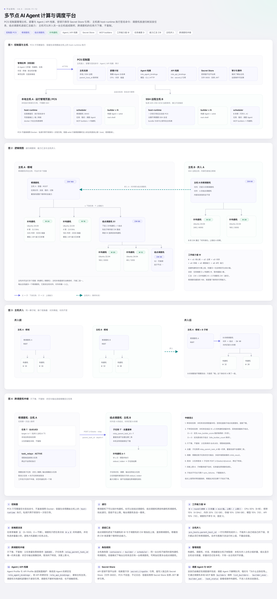
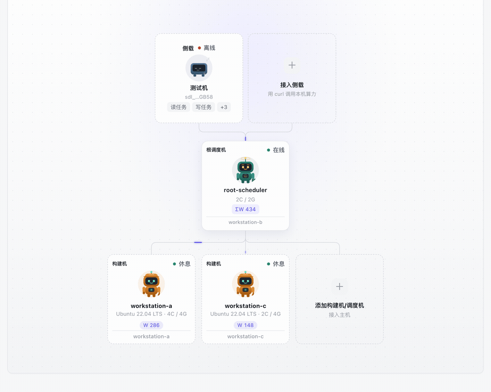
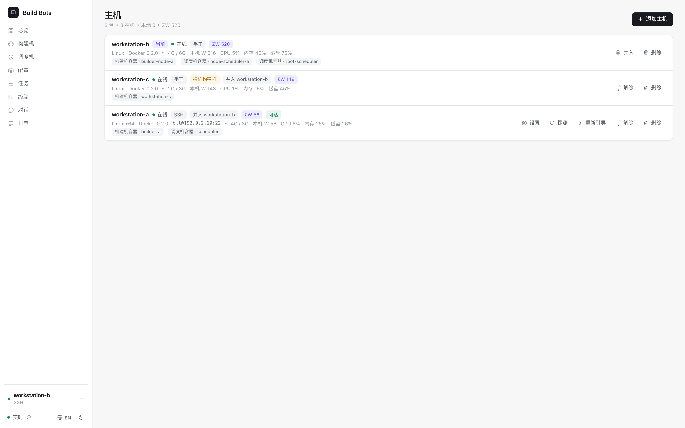
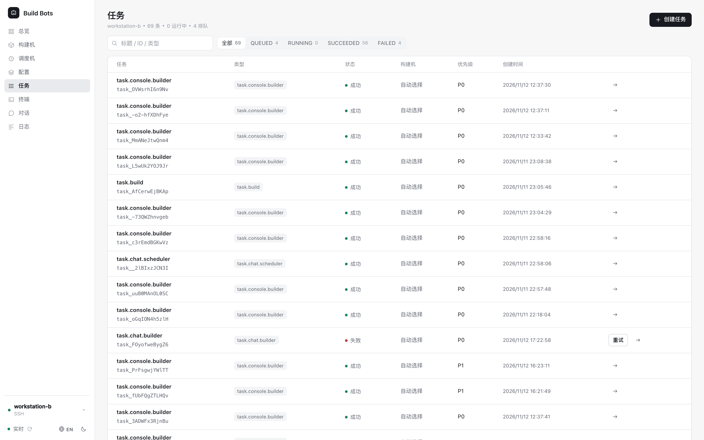

<div align="center">

# 多节点 AI Agent 计算与调度平台

**在任意多台主机上运行 Claude Code、Codex、DeepSeek 或普通 Shell —— 确定性调度、递归调度机、满权限构建机。**

[快速开始](#快速开始) · [架构](#架构) · [界面](#界面) · [文档](#文档) · **[English](README.md)**

[](https://github.com/UnmetDecade/OSACP/actions/workflows/ci.yml)
[](LICENSE)
[](https://github.com/UnmetDecade/OSACP/releases)


</div>

---

AI 编码 Agent 启动很容易，跨机器稳定运行很难。这个平台把运营核心做得**朴素且确定**：调度机做决定，构建机执行，Agent 只负责解释。

它面向 1–10 人的研发团队：要一块真正的算力场地，而不是多租户 SaaS、不是 Kubernetes 发行版，也不是又一套审批流。


## 为什么做它

| | |
|---|---|
| **派发是确定性的** | 排队顺序、准入、租约与 fencing 都是 PostgreSQL 里的普通规则。大模型不决定谁跑什么。 |
| **调度机递归成树** | 每台主机一台根调度机；结点调度机挂在下面继续递归，各自一套库、各自名下的构建机。 |
| **主机可联邦** | 主机可以并入另一台主机：它的根在父视角里变成结点，`ΣW` 沿树汇总；脱离只改一行引用，不重启容器。 |
| **构建机就是机器** | 官方 Ubuntu 容器或整台裸机，root SSH、自己的工具链、真实 shell。不是假沙箱。 |
| **Agent 不绑定** | Claude Code、Codex、DeepSeek 或自定义 CLI/HTTP Agent。档案只存引用，密钥运行时解析。 |
| **对话与终端也是任务** | 对话和容器终端走同一条任务管线、同一套租约与 fencing，没有旁路执行器。 |

## 架构

<a href="docs/开源分布式AI-Agent计算与调度平台架构图.html">
  
</a>

<p align="center"><sub>点击架构图打开完整 HTML 版本。</sub></p>

四个活动部件：

- **PCS** 是控制面。它持有主机名册、部署计划、Agent/API 档案、Secret Store 引用与审计；只写期望态和签名命令，从不直接调用 Docker。
- **host-runtime** 跑在每台主机上。它向 PCS 长轮询、验证 Ed25519 命令、创建容器、上报实际态与资源；只出站，不监听管理端口。
- **调度机** 是状态权威。它排队、准入、发租约、fencing、派发、记账。根与结点调度机组成递归树；跨调度机的任务只下推，不复制。
- **构建机** 是唯一的工作角色。它领取任务，运行 Agent 适配器或确定性 Shell，持续上报进度并上传产物。

完整模型（能力值 `W`、任务难度 `D`、`ΣW` 汇总、中继深度）见[架构图](docs/开源分布式AI-Agent计算与调度平台架构图.html)与 [docs/architecture.md](docs/architecture.md)。

## 界面



<p align="center"><sub>实时工作室：新构建机出现在所属调度机下，在线链路上有任务信号流过。</sub></p>

<p align="center">
  
  
</p>

<p align="center"><sub>左：主机与联邦 · 右：任务与租约</sub></p>

工作室是主界面：根调度机在上，结点调度机与构建机在下，每条在线链路都有流动信号。每张卡片带所属主机、资源规格与能力值；新增构建机或调度机也从同一棵树进入——你点的那张「＋」卡片已经决定了父结点。

## 快速开始

要求：Node 22+、PostgreSQL 16（或 Docker）、Docker 24+。

### 1. 单机 Compose

```bash
cd deploy
cp .env.example .env                 # 改 POSTGRES_PASSWORD；模型凭据可以留空
mkdir -p keys tokens data/postgres data/artifacts

ssh-keygen -t ed25519 -N "" -f keys/scheduler
ssh-keygen -t ed25519 -N "" -f keys/builder
for os in 20 22 24 26; do cp keys/builder.pub "keys/builder$os.pub"; done

docker compose -f compose.yaml --env-file .env up -d --build
```

调度机 API：`http://<host>:8443`。构建机 SSH：2222–2225，仅密钥，root shell。

### 2. 控制面（多主机）

```bash
cd pcs-issuer
npm install
npm run keygen
npm run migrate

umask 077 && openssl rand -out ~/.config/platform/pcs-credential.key 32
PCS_HOST=0.0.0.0 \
PCS_RUNTIME_URL=http://pcs.example:7901 \
PCS_CREDENTIAL_KEY_FILE=$HOME/.config/platform/pcs-credential.key \
PCS_IMAGE_ALLOWLIST=docker.io/library/ \
npm start
```

在管理应用里添加本地主机或 SSH 主机，启动 runtime，再部署调度机与构建机。完整步骤见 [docs/deployment.md](docs/deployment.md) 与 [deploy/README.md](deploy/README.md)。

### 3. 管理应用

```bash
cd admin-app
npm install
printf 'PCS_ADMIN_TOKEN=%s\n' '<admin-jwt>' > .env.local   # 0600，已被 gitignore
npm run dev
```

开发代理把 `/api/pcs` 转到 `127.0.0.1:7901`、`/api/scheduler` 转到 `127.0.0.1:8443`。管理员令牌这样签发：

```bash
npm --prefix pcs-issuer run pcs -- admin-token --operator <name>
```

## 核心模型

| 概念 | 怎么工作 |
|---|---|
| **根 / 结点调度机** | 每台主机一台根，下面可挂任意多台结点。结点有自己的构建机与数据库，不直接调度别的结点的构建机。 |
| **能力值 `W`** | 创建构建机时按 CPU、内存、磁盘、系统、Agent、API 六项归一化到 0–1000，然后冻结。 |
| **任务难度 `D`** | 提交时给出。只有 `W ≥ D` 且能力子集匹配的构建机才能领取。 |
| **`ΣW`** | 调度机上报整棵子树在线构建机的能力之和；根能看到整个联邦的容量。 |
| **租约与 fencing** | 每次领取生成 attempt、租约与 fencing token；旧 token 写入返回 `409 FENCING_STALE`。 |
| **Agent / API 档案** | PCS 保存档案与绑定；调度机只看见 `profile_id` 引用，从不接触密钥。 |
| **Secret Store** | 档案只存 `secret://` 引用；按实例身份解析成短期凭据，审计不记录值。 |
| **中继** | `D > W` 的任务下推到子调度机，不复制；结果沿链上浮，最大深度 8。 |

## 仓库结构

| 路径 | 职责 |
|---|---|
| [`scheduler/`](scheduler/) | 任务状态机、队列、租约、fencing、事件、联邦中继 |
| [`pcs-issuer/`](pcs-issuer/) | PCS 控制面：主机、部署计划、签名命令、档案、审计 |
| [`host-runtime/`](host-runtime/) | 主机守护进程：注册、验签、创建容器、上报资源 |
| [`admin-app/`](admin-app/) | React 19 + Vite 控制台：总览、主机、构建机、调度机、档案、任务、终端、对话、日志 |
| [`secret-store/`](secret-store/) | Secret Store 参考实现，按实例解析短期凭据 |
| [`agents/`](agents/) | Claude Code / Codex / 自定义 CLI 的 Agent 适配器 |
| [`deploy/`](deploy/) | 单机 Compose、容器入口、部署载荷构建 |
| [`docs/`](docs/) | 架构、构建机、调度机、管理应用、联邦、部署文档 |
| [`scripts/`](scripts/) | 验收、压测、备份、PKI 与载荷脚本 |

## 安全模型

这是一套**可信内网里的研发平台**，取舍是明确的：

- 构建机默认 `root` + 完整 SSH + 可访问外网。这是刻意的：装包、排障、复现都要自由。
- 没有 RBAC、审批门或权限矩阵；能打开控制台就能操作全部功能。
- PCS 不执行 Docker 命令；host-runtime 验签后才动作。
- 构建机 SSH 只允许密钥；主机登录公钥在部署时注入。
- PCS 用 AES-256-GCM 加密主机私钥，接口只返回指纹。
- 模型凭据只留在运行时容器，并经过 `PLATFORM_AGENT_PASS_ENV` 与 Profile `--pass-env` 两层放行。
- PCS（7901）、调度机 API（8443）与 SSH 端口必须放在防火墙或 VPN 后面，不要直接暴露公网。

漏洞报告方式见 [SECURITY.md](SECURITY.md)。

## 开发与测试

```bash
cd scheduler   && npm install && npm run typecheck && npm test
cd pcs-issuer  && npm install && npm run typecheck && npm test   # 需要 PostgreSQL
cd host-runtime && npm install && npm run typecheck && npm test
cd secret-store && npm install && npm run typecheck && npm test
cd admin-app   && npm install && npm run build
```

验收与压测脚本见 [scripts/README.md](scripts/README.md)。这些脚本会建库、重置数据，不要在承载真实业务的控制面上直接运行。

## 文档

- [总体架构](docs/architecture.md)
- [控制面与主机联邦](docs/federation.md)
- [构建机](docs/builders.md)
- [调度机](docs/scheduler.md)
- [管理应用](docs/admin-app.md)
- [部署](docs/deployment.md)
- [English README](README.md)

## 许可证

[MIT](LICENSE)。可以随意使用、修改、商用，保留版权声明即可。
