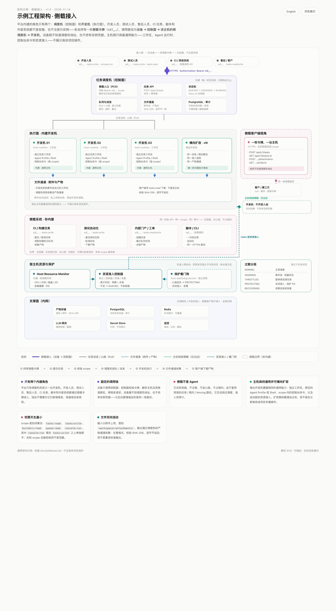

<div align="center">

# 多节点 AI Agent 计算与调度平台

**在任意多台主机上运行 Claude Code、Codex、DeepSeek 或普通 Shell —— 确定性调度、递归调度机、满权限构建机。**

[快速开始](#快速开始) · [架构](#架构) · [示例](#示例工程架构) · [调度算法](#调度算法) · [界面](#界面) · [文档](#文档) · **[English](README.md)**

[](https://github.com/UnmetDecade/OSACP/actions/workflows/ci.yml)
[](LICENSE)
[](https://github.com/UnmetDecade/OSACP/releases)


</div>

---

AI 编码 Agent 启动很容易，跨机器稳定运行很难。这个平台把运营核心做得**朴素且确定**：调度机做决定，构建机执行，Agent 只负责解释。

它面向 1–10 人的研发团队：要一块真正的算力场地，而不是多租户 SaaS、不是 Kubernetes 发行版，也不是又一套审批流。


## 为什么做它

| | |
|---|---|
| **派发是确定性的** | 排队顺序、准入、租约与 fencing 都是 PostgreSQL 里的普通规则。大模型不决定谁跑什么。 |
| **调度机递归成树** | 每台主机一台根调度机；结点调度机挂在下面继续递归，各自一套库、各自名下的构建机。 |
| **主机可联邦** | 主机可以并入另一台主机：它的根在父视角里变成结点，`ΣW` 沿树汇总；脱离只改一行引用，不重启容器。 |
| **构建机就是机器** | 官方 Ubuntu 容器或整台裸机，root SSH、自己的工具链、真实 shell。不是假沙箱。 |
| **Agent 不绑定** | Claude Code、Codex、DeepSeek 或自定义 CLI/HTTP Agent。档案只存引用，密钥运行时解析。 |
| **对话与终端也是任务** | 对话和容器终端走同一条任务管线、同一套租约与 fencing，没有旁路执行器。 |
| **文件双向进出** | 输入附件在命令执行前落进工作区；收集到的产物走专用产物通道（单文件 64 MiB，SHA-256 校验）并按原始字节下载，不靠 stdout 里的 base64。 |
| **局域网设备走同一条链路** | 侧载令牌让一台设备用 `curl` 驱动某台主机的构建机 —— 与控制台同一套任务、租约与 fencing，权限是封闭集合，也拿不到调度机地址。 |

## 架构

<a href="https://unmetdecade.github.io/OSACP/Open-Source-Agent-Compute-Platform-Architecture.zh-CN.html">
  
</a>

<p align="center"><sub>点击架构图打开完整 HTML 版本。</sub></p>

四个活动部件：

- **PCS** 是控制面。它持有主机名册、部署计划、Agent/API 档案、Secret Store 引用与审计；只写期望态和签名命令，从不直接调用 Docker。
- **host-runtime** 跑在每台主机上。它向 PCS 长轮询、验证 Ed25519 命令、创建容器、上报实际态与资源；只出站，不监听管理端口。
- **调度机** 是状态权威。它排队、准入、发租约、fencing、派发、记账。根与结点调度机组成递归树；跨调度机的任务只下推，不复制。
- **构建机** 是唯一的工作角色。它领取任务，运行 Agent 适配器或确定性 Shell，持续上报进度并上传产物。

侧载不是第五个部件：它是一枚按主机限定的令牌，从 PCS 进来后落到该主机的根调度机，所以局域网设备走的是和控制台一样的任务链路。文件跟着任务走 —— 附件进、产物出。

完整模型（能力值 `W`、任务难度 `D`、`ΣW` 汇总、中继深度）见[架构图](https://unmetdecade.github.io/OSACP/Open-Source-Agent-Compute-Platform-Architecture.zh-CN.html)与 [docs/architecture.zh-CN.md](docs/architecture.zh-CN.md)。

## 示例工程架构

<a href="https://unmetdecade.github.io/OSACP/example-project-architecture.zh-CN.html">
  
</a>

<p align="center"><sub>内建的只有调度机和 N 台开发机；其他参与者全部通过侧载令牌进入。点击打开可交互 HTML 版本。</sub></p>

这是一套今天就能落地的形态：

- **多机研发自动化** — 一台调度机 + N 台开发机；扩容靠增加开发机，而不是新增角色。
- **Agent 驱动交付** — 开发人员和测试人员从管理端或 `curl` 提交任务；Claude Code / Codex / DeepSeek / Shell 在绑定的 Agent Profile 中执行。
- **CI 与测试自动化** — CI 任务用一枚 `sdl_…` 令牌提交任务、轮询状态、下载产物，不需要安装 Agent。
- **售后与客户接入** — 售后人员或客户脚本提交任务并读取结果，始终不知道调度机地址。
- **文件双向流动** — 附件进、产物出，SHA-256 校验，逐字节返回。

平台内建的只有调度机和开发机，其他参与者都是侧载客户端；因此所有人都走同一套任务、租约、fencing 和审计路径——不需要新增容器、角色或派发规则。

## 界面


<p align="center"><sub>实时工作室：新构建机出现在所属调度机下，在线链路上有任务信号流过。</sub></p>

<p align="center">
  
  
</p>

<p align="center"><sub>左：主机与联邦 · 右：任务与租约</sub></p>

工作室是主界面：根调度机在上，结点调度机与构建机在下，每条在线链路都有流动信号。每张卡片带所属主机、资源规格与能力值；新增构建机或调度机也从同一棵树进入——你点的那张「＋」卡片已经决定了父结点。

## 快速开始

要求：Node 22+、PostgreSQL 16（或 Docker）、Docker 24+。

### 1. 单机 Compose

```bash
cd deploy
cp .env.example .env                 # 改 POSTGRES_PASSWORD；模型凭据可以留空
mkdir -p keys tokens data/postgres data/artifacts

ssh-keygen -t ed25519 -N "" -f keys/scheduler
ssh-keygen -t ed25519 -N "" -f keys/builder
for os in 20 22 24 26; do cp keys/builder.pub "keys/builder$os.pub"; done

docker compose -f compose.yaml --env-file .env up -d --build
```

调度机 API：`http://<host>:8443`。构建机 SSH：2222–2225，仅密钥，root shell。

### 2. 控制面（多主机）

```bash
cd pcs-issuer
npm install
npm run keygen
npm run migrate

umask 077 && openssl rand -out ~/.config/platform/pcs-credential.key 32
PCS_HOST=0.0.0.0 \
PCS_RUNTIME_URL=http://pcs.example:7901 \
PCS_CREDENTIAL_KEY_FILE=$HOME/.config/platform/pcs-credential.key \
PCS_IMAGE_ALLOWLIST=docker.io/library/ \
npm start
```

在管理应用里添加本地主机或 SSH 主机，启动 runtime，再部署调度机与构建机。完整步骤见 [docs/deployment.zh-CN.md](docs/deployment.zh-CN.md) 与 [deploy/README.zh-CN.md](deploy/README.zh-CN.md)。

### 3. 管理应用

```bash
cd admin-app
npm install
printf 'PCS_ADMIN_TOKEN=%s\n' '<admin-jwt>' > .env.local   # 0600，已被 gitignore
npm run dev
```

开发代理把 `/api/pcs` 转到 `127.0.0.1:7901`、`/api/scheduler` 转到 `127.0.0.1:8443`。管理员令牌这样签发：

```bash
npm --prefix pcs-issuer run pcs -- admin-token --operator <name>
```

### 4. 可选：从另一台设备驱动主机

在工作室里点「接入侧载」创建令牌，然后带文件跑一个项目：

```bash
SIDELOAD_TOKEN='sdl_…' PCS_URL='http://pcs.example:7901' \
  node scripts/sideload-project.mjs --out ./out \
  --upload ./input/data.csv \
  --command 'g++ -O2 -std=c++17 hello.cpp -o hello && ./hello > result.txt' \
  --collect .
```

输入在命令执行前落到 `attachments/`；收集路径下的每个文件都会下载到 `--out`，并按调度机的 SHA-256 校验。

## 核心模型

| 概念 | 怎么工作 |
|---|---|
| **根 / 结点调度机** | 每台主机一台根，下面可挂任意多台结点。结点有自己的构建机与数据库，不直接调度别的结点的构建机。 |
| **能力值 `W`** | 按 CPU 核数、主频、内存、磁盘、模型能力、API 能力六项归一化到 0–1000。静态模式在部署时冻结；动态模式让与负载相关的那一半保持实时（`W_static + H_res × W_res`）。 |
| **任务难度 `D`** | 提交时给出。只有 `W ≥ D` 且能力子集匹配的构建机才能领取。 |
| **`ΣW`** | 调度机上报整棵子树在线构建机的能力之和；根能看到整个联邦的容量。 |
| **租约与 fencing** | 每次领取生成 attempt、租约与 fencing token；旧 token 写入返回 `409 FENCING_STALE`。 |
| **Agent / API 档案** | PCS 保存档案与绑定；调度机只看见 `profile_id` 引用，从不接触密钥。 |
| **Secret Store** | 档案只存 `secret://` 引用；按实例身份解析成短期凭据，审计不记录值。 |
| **中继** | `D > W` 的任务下推到子调度机，不复制；结果沿链上浮，最大深度 8。 |
| **文件** | `requirements.console.attachments` 在命令执行前写入 `<workspace>/attachments/`。`collect` 扫描工作区（32 个路径 / 128 个文件，单文件 64 MiB、合计 256 MiB），每个文件都带新的 SHA-256 进入产物通道。 |
| **侧载** | `sdl_` 令牌绑定到单台主机，平台只存 SHA-256 哈希与末四位。权限是封闭集合，`console:run` 单独放行 Shell 任务；调用链是 `设备 → PCS → 根调度机`。 |

## 调度算法

两种模式，一套契约。**静态模式**给每个部署固定预算、能力值部署时冻结；**动态模式**给每台主机一个 cgroup 资源池，每 5 秒重算一次实例的公平份额。模式在根调度机上选定一次，整棵子树继承。两条路径共用同一套队列、租约、fencing 与中继代码，所有决策都是 PostgreSQL 行上的整数运算 —— 热路径里没有大模型、没有随机数、没有浮点。

### 能力值

```
W = 1000 × ( 0.30·cpu/8 + 0.15·freq/4 + 0.20·mem/32
           + 0.10·disk/256 + 0.15·model/10 + 0.10·api/10 )        （每项封顶 1）
```

动态模式把分数拆成与负载无关、与负载相关两半：

```
W_static = 1000 × (0.15·freq/4 + 0.10·disk/256 + 0.15·model/10 + 0.10·api/10)   ∈ [0, 500]
W_res    = 1000 × (0.30·cpu/8 + 0.20·mem/32)                                    ∈ [0, 500]
W0       = W_static + W_res(cap)                  -- 上限
W_live   = W_static + H_res × W_res(cap)          -- 实时
H_res    = clamp(1 − max(U_mem, U_cpu), 0.05, 1)  -- 真实用量，EWMA α = 0.3
W_dispatch = P25(最近 15 s 的 W_live)             -- 派发实际使用的值
```

已承诺但未使用的授予不降低 `W_live`，只降低准入预算。同一个分配不会因此被惩罚两次。

### 加权 max-min 注水

每个实例的需求是 `demand = min(cap, max(reserved, used, idle_floor))` —— 预留、实际用量与地板先统一，再谈共享。权重来自声明的 cap，分配器按权重比例、全程整数地填满需求：

```
g_i = min(demand_i, cap_i, floor)
while 还有容量 and 仍有 g_i < min(demand_i, cap_i):
    每个实例增加 min(剩余空间_i, ⌊remaining × weight_i / Σweight⌋)
余数 → 按 instance_id 一次一毫核 / 一字节补齐
```

空闲容量绝不强行摊出去；相同输入必然得到相同授予；CPU 与内存独立注水。授予写入 `memory.low` / `cpu.weight`，上限写入 `memory.max` / `cpu.max`；压力下 `memory.high` 被压到 `1.1 × 授予`（`PRESSURE`）或 `1.0 × 授予`（`CRITICAL`）。授予被压到已承诺量以下的实例标记为 `OVERCOMMITTED`：继续运行，但不再接收新任务。

### 按任务类型的并发

```
k(i, τ) = min( ⌊(budget_cpu − reserved_cpu) / request_cpu(τ)⌋,
               ⌊(budget_mem − reserved_mem) / request_mem(τ)⌋ )
budget = min(cap, max(grant, fair_share))
仅当 k ≥ 1 且 active_of_type(τ) < task_type_instance_limit 时准入
```

`k` 可以为 0，表示这台构建机完全接不了该类型。动态构建机只有当前代数的授予到达 `APPLIED` 后才启动任务，所以不存在「没有强制上限仍在跑」的情况。

### 压力与降载

池子沿 `NORMAL → BUSY → PRESSURE → CRITICAL → RECOVERING → NORMAL` 迁移，进入与退出阈值分离（进入 0.70/0.85/0.95，退出 0.60/0.75/0.90），因此不会抖动。新领取只在 `NORMAL`、`BUSY`、`RECOVERING` 放行；`PRESSURE` 与 `CRITICAL` 直接停止准入，而不是杀任务。为了回收内存触发 OOM 是不存在的。

### 队列纪律

```
effective_priority = priority_class − ⌊等待秒数 / aging_after⌋      （P0 永不老化）
ORDER BY effective_priority, enqueued_at, task_id
```

每次领取扫描最多 20 个有序候选，而不是 `LIMIT 1`；被阻塞的候选会持久化记录阻塞原因，并按指数退避重试（1 s 起翻倍，封顶 60 s）。需求永远放不下的任务在 8 次尝试后标记 `UNSCHEDULABLE`，不再空转。中继在 `D > 0` 时选**刚好够用**的子节点，`D = 0` 时选最空闲的，优先同模式与准入友好的压力状态，最大深度 8。

完整推导、算例、授予生命周期与配置表（含哪些字段仍是预留项）见 [docs/scheduling-algorithm.zh-CN.md](docs/scheduling-algorithm.zh-CN.md)。

## 仓库结构

| 路径 | 职责 |
|---|---|
| [`scheduler/`](scheduler/README.zh-CN.md) | 任务状态机、队列、租约、fencing、事件、联邦中继 |
| [`pcs-issuer/`](pcs-issuer/README.zh-CN.md) | PCS 控制面：主机、部署计划、签名命令、档案、审计 |
| [`host-runtime/`](host-runtime/README.zh-CN.md) | 主机守护进程：注册、验签、创建容器、上报资源 |
| [`admin-app/`](admin-app/README.zh-CN.md) | React 19 + Vite 控制台：总览、主机、构建机、调度机、档案、任务、终端、对话、日志 |
| [`secret-store/`](secret-store/README.zh-CN.md) | Secret Store 参考实现，按实例解析短期凭据 |
| [`agents/`](agents/README.zh-CN.md) | Claude Code / Codex / 自定义 CLI 的 Agent 适配器 |
| [`deploy/`](deploy/README.zh-CN.md) | 单机 Compose、容器入口、部署载荷构建 |
| [`docs/`](docs/) | 架构、调度算法、构建机、调度机、管理应用、侧载、联邦、部署文档 |
| [`scripts/`](scripts/README.zh-CN.md) | 验收、压测、备份、PKI、载荷与侧载脚本 |

## 安全模型

这是一套**可信内网里的研发平台**，取舍是明确的：

- 构建机默认 `root` + 完整 SSH + 可访问外网。这是刻意的：装包、排障、复现都要自由。
- 没有 RBAC、审批门或权限矩阵；能打开控制台就能操作全部功能。
- PCS 不执行 Docker 命令；host-runtime 验签后才动作。
- 构建机 SSH 只允许密钥；主机登录公钥在部署时注入。
- PCS 用 AES-256-GCM 加密主机私钥，接口只返回指纹。
- 模型凭据只留在运行时容器，并经过 `PLATFORM_AGENT_PASS_ENV` 与 Profile `--pass-env` 两层放行。
- 侧载令牌只展示一次、只存 SHA-256 哈希，且只连 PCS；设备看不到调度机地址与实例凭据。
- PCS（7901）、调度机 API（8443）与 SSH 端口必须放在防火墙或 VPN 后面，不要直接暴露公网。

漏洞报告方式见 [SECURITY.zh-CN.md](SECURITY.zh-CN.md)。

## 开发与测试

```bash
cd scheduler   && npm install && npm run typecheck && npm test
cd pcs-issuer  && npm install && npm run typecheck && npm test   # 需要 PostgreSQL
cd host-runtime && npm install && npm run typecheck && npm test
cd secret-store && npm install && npm run typecheck && npm test
cd admin-app   && npm install && npm run lint && npm test && npm run build
```

验收与压测脚本见 [scripts/README.zh-CN.md](scripts/README.zh-CN.md)。这些脚本会建库、重置数据，不要在承载真实业务的控制面上直接运行。

完整的环境准备、检查项、代码规范和发版流程见 [CONTRIBUTING.zh-CN.md](CONTRIBUTING.zh-CN.md)。参与本项目即表示同意 [行为准则](CODE_OF_CONDUCT.zh-CN.md)。版本变更记录见 [CHANGELOG.zh-CN.md](CHANGELOG.zh-CN.md)。

## 文档

每篇设计文档都有英文默认版和中文版；交互式架构图托管在[文档站](https://unmetdecade.github.io/OSACP/)。

- [总体架构](docs/architecture.zh-CN.md)
- [分配调度算法](docs/scheduling-algorithm.zh-CN.md) —— 能力值评分、注水分配、压力处理、中继
- [控制面与主机联邦](docs/federation.zh-CN.md)
- [构建机](docs/builders.zh-CN.md)
- [调度机](docs/scheduler.zh-CN.md)
- [管理应用](docs/admin-app.zh-CN.md)
- [Agent 控制](docs/agent-control.zh-CN.md) —— 任务暂停、自主程度、归类结果、失败分类
- [侧载](docs/sideload.zh-CN.md) —— curl 令牌、权限、文件收发
- [示例工程架构](https://unmetdecade.github.io/OSACP/example-project-architecture.zh-CN.html) —— 一台调度机 + N 台开发机的实际部署形态
- [部署](docs/deployment.zh-CN.md)
- [English README](README.md)

## 许可证

[MIT](LICENSE)。可以随意使用、修改、商用，保留版权声明即可。
